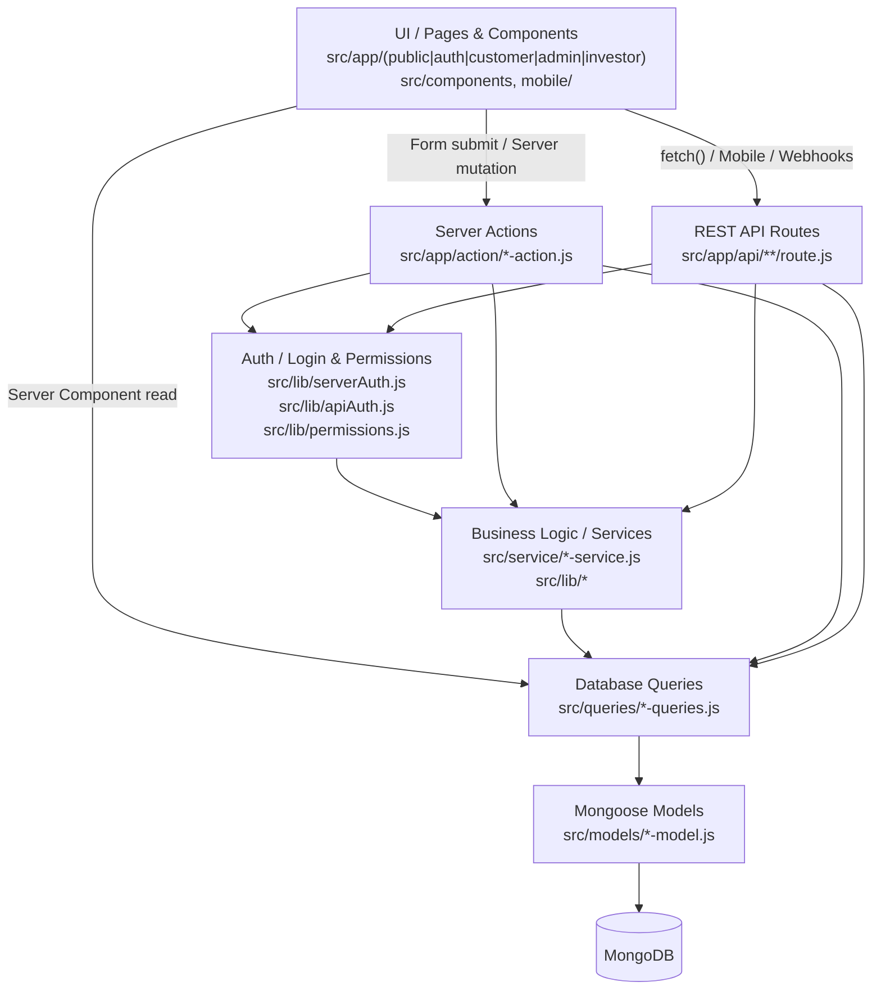

# Crossbar Metro Arena — Project Architecture & Development Flow

This document defines the standard layered architecture and coding flow for this project. Every new feature and refactor should follow this structure:

> **Model → Queries → Service / Logic & Auth (Login) → Action / API → UI**

---

## 1. High-Level Flow



### Layer Responsibilities (At a Glance)

| Layer | Folder | Naming Format | Responsibility |
| --- | --- | --- | --- |
| **1. Model** | `src/models/` | `<name>-model.js` | Mongoose schema, field rules, indexes, model export only |
| **2. Queries** | `src/queries/` | `<name>-queries.js` | Reusable MongoDB reads/writes (`find`, `findOne`, `create`, `update`, `delete`, aggregations) |
| **3. Service / Logic** | `src/service/` & `src/lib/` | `<name>-service.js` | Business rules, calculations, multi-model orchestration, DB connection |
| **4. Auth / Login** | `src/app/api/auth/`, `src/lib/serverAuth.js`, `src/lib/apiAuth.js`, `src/middleware.js` | — | Login, registration, JWT cookies, role & permission guards |
| **5. Actions** | `src/app/action/` | `<name>-action.js` | Next.js Server Actions (`"use server"`) for UI mutations & `revalidatePath()` |
| **6. API** | `src/app/api/` | `<resource>/route.js` | HTTP REST endpoints (`GET`, `POST`, `PATCH`, `DELETE`) for web, mobile app, and webhooks |
| **7. Utilities** | `src/utils/` | `<name>.js` | Pure helper functions (date, phone, storage, cloudinary, mail) |
| **8. UI** | `src/app/(group)/`, `src/components/` | `page.jsx`, `Component.jsx` | Pages, layouts, client components, and context |

---

## 2. Folder Structure

```text
src/
├── models/                     # 1. Mongoose schemas & models (*-model.js)
│   ├── booking-model.js
│   ├── challenge-model.js
│   ├── customer-model.js
│   ├── customer-setting-model.js
│   ├── expense-model.js
│   ├── gallery-photo-model.js
│   ├── investor-model.js
│   ├── match-result-model.js
│   ├── other-income-model.js
│   ├── payout-model.js
│   ├── product-model.js
│   ├── refund-model.js
│   ├── role-model.js
│   ├── setting-model.js
│   ├── shop-reservation-model.js
│   ├── team-model.js
│   ├── tournament-model.js
│   ├── tournament-registration-model.js
│   └── user-model.js
│
├── queries/                    # 2. Reusable DB query functions (*-queries.js)
│   ├── booking-queries.js
│   ├── customer-queries.js
│   └── ...
│
├── service/                    # 3. DB connection & domain services (*-service.js)
│   ├── mongo.js
│   └── <feature>-service.js
│
├── lib/                        # Core helpers (auth, permissions, validation, domain logic)
│   ├── mongodb.js              # Active MongoDB connection helper
│   ├── serverAuth.js           # JWT sign/verify & cookie helpers
│   ├── apiAuth.js              # requireAuth, requirePermission, optionalAuth, rateLimit
│   ├── permissions.js          # Role & staff permission definitions
│   ├── validate.js             # Request JSON parsing & error responses
│   └── ...
│
├── utils/                      # Shared pure utilities (storage, uploads, mail, etc.)
│
├── app/
│   ├── action/                 # 4a. Next.js Server Actions (*-action.js)
│   │   ├── auth-action.js
│   │   ├── booking-action.js
│   │   └── ...
│   │
│   ├── api/                    # 4b. REST API Route Handlers (**/route.js)
│   │   ├── auth/               # login, register, logout, me
│   │   ├── bookings/
│   │   ├── customers/
│   │   ├── payment/sslcommerz/
│   │   └── ...
│   │
│   ├── (public)/               # Public pages
│   ├── (auth)/                 # Login, register, logout pages
│   ├── (customer)/             # Customer panel (/customer)
│   ├── (admin)/                # Admin portal (/admin)
│   └── (investor)/             # Investor portal (/investor)
│
├── components/                 # Reusable UI components
├── context/                    # React Context providers
└── middleware.js               # Route protection & security headers
```

---

## 3. Layer-by-Layer Guidelines & Templates

### Step 1: Model (`src/models/<name>-model.js`)

- File name **must** be lowercase kebab-case ending with `-model.js` (example: `booking-model.js`, `customer-setting-model.js`).
- Keep only schema definitions, defaults, enums, indexes, and schema methods here.
- Always guard model compilation with `mongoose.models.<Name> || mongoose.model('<Name>', Schema)` for Next.js hot reloads.
- Export both named and default exports.

```js
// src/models/booking-model.js
import mongoose, { Schema } from 'mongoose';

const BookingSchema = new Schema(
  {
    bookingCode: { type: String, required: true, unique: true, trim: true },
    date: { type: String, required: true, index: true },
    slotNumber: { type: Number, required: true },
    // ...fields
  },
  {
    timestamps: true,
    toJSON: {
      transform(_doc, ret) {
        ret.id = ret._id.toString();
        delete ret.__v;
        return ret;
      },
    },
  }
);

export const Booking =
  mongoose.models.Booking || mongoose.model('Booking', BookingSchema);
export default Booking;
```

---

### Step 2: Queries (`src/queries/<name>-queries.js`)

- File name: `<name>-queries.js` (example: `booking-queries.js`, `user-queries.js`).
- Every query function calls `await connectToDatabase()` before touching Mongoose.
- Responsible **only** for database operations (fetching, filtering, sorting, creating, updating, deleting) and returning plain serialized objects (`.lean()` + `id` normalization).
- Do **not** read `request`, set cookies, or return `NextResponse` here.

```js
// src/queries/booking-queries.js
import { connectToDatabase } from '@/lib/mongodb';
import { Booking } from '@/models/booking-model';

function serialize(doc) {
  if (!doc) return null;
  const obj = typeof doc.toJSON === 'function' ? doc.toJSON() : { ...doc, id: String(doc._id) };
  delete obj.__v;
  return obj;
}

export async function findBookings(filter = {}, sort = { date: -1, slotNumber: 1 }) {
  await connectToDatabase();
  const docs = await Booking.find(filter).sort(sort).lean();
  return docs.map(serialize);
}

export async function findBookingById(id) {
  await connectToDatabase();
  const doc = await Booking.findById(id).lean();
  return serialize(doc);
}

export async function createBookingRecord(payload) {
  await connectToDatabase();
  const doc = await Booking.create(payload);
  return serialize(doc);
}

export async function updateBookingById(id, updates) {
  await connectToDatabase();
  const doc = await Booking.findByIdAndUpdate(id, updates, { new: true }).lean();
  return serialize(doc);
}
```

---

### Step 3: Business Logic / Services (`src/service/<name>-service.js` & `src/lib/`)

- Put multi-step business logic here so both **Server Actions** and **API Routes** can reuse the exact same rules without duplicating code.
- Examples:
  - Calculating slot prices & add-ons
  - Expiring stale payment holds & checking double-bookings
  - Syncing a customer record after a booking or registration
  - Confirming SSLCommerz payments and generating refunds
- Services call `src/queries/*-queries.js` (never HTTP objects like `NextResponse`).

```js
// src/service/booking-service.js
import { findBookings, createBookingRecord } from '@/queries/booking-queries';
import { generateBookingCode, slotPrice } from '@/lib/booking';

export async function createTurfBooking(input, currentUser) {
  // 1. Apply domain validation & pricing rules
  const price = slotPrice(input.date, input.slotNumber);
  const bookingCode = generateBookingCode();

  // 2. Persist via queries layer
  return createBookingRecord({
    ...input,
    bookingCode,
    courtPrice: price,
    totalPrice: price + (input.addOnsPrice || 0),
    userId: currentUser?.userId || '',
  });
}

export async function getBookingsForDate(date) {
  return findBookings({ date, paymentStatus: { $ne: 'cancelled' } });
}
```

---

### Step 4: Auth / Login Flow (`src/app/api/auth/`, `src/lib/serverAuth.js`, `src/lib/apiAuth.js`, `src/middleware.js`)

Authentication and authorization sit in front of protected Actions and API routes:

1. **Login (`POST /api/auth/login`)**:
   - Rate-limits by IP and mobile number (`rateLimit()`).
   - Validates 11-digit Bangladeshi mobile number (`01[3-9]\d{8}`).
   - Looks up user in `src/models/user-model.js` (via query/model) and verifies password (`user.comparePassword()`).
   - Signs JWT via `signJwtToken()` and sets HTTP-only auth cookies via `setAuthCookies()`.
   - Loads staff role permissions (`loadAccess(user)`) from `src/models/role-model.js`.
2. **Route Middleware (`src/middleware.js`)**:
   - Guards `/admin`, `/investor`, and `/customer` route groups based on session cookie & role.
3. **API / Action Guards (`src/lib/apiAuth.js`)**:
   - `optionalAuth(request)` — returns logged-in user or `null` (public + personalized routes).
   - `requireAuth(request)` — requires any authenticated user.
   - `requirePermission(request, 'bookings')` — requires admin or staff with the given permission.

---

### Step 5A: Server Actions (`src/app/action/<name>-action.js`)

Use **Server Actions** for Next.js web UI mutations (form submissions, admin desk actions, customer profile updates) where direct server invocation + cache revalidation is preferred.

- Always start the file with `'use server';`.
- Keep actions thin: **verify auth → validate input → call service/query → `revalidatePath()` → return `{ success, data | error }`**.

```js
// src/app/action/booking-action.js
'use server';

import { revalidatePath } from 'next/cache';
import { createTurfBooking } from '@/service/booking-service';

export async function createBookingAction(input) {
  try {
    // 1. Validate / check session
    if (!input?.date || !input?.slotNumber) {
      return { success: false, error: 'Date and slot are required.' };
    }

    // 2. Execute business logic
    const booking = await createTurfBooking(input, null);

    // 3. Revalidate affected pages
    revalidatePath('/booking');
    revalidatePath('/admin/bookings');

    return { success: true, booking };
  } catch (err) {
    console.error('createBookingAction error:', err);
    return { success: false, error: err.message || 'Failed to create booking.' };
  }
}
```

---

### Step 5B: API Route Handlers (`src/app/api/<resource>/route.js`)

Use **API routes** for:
- Client-side `fetch()` calls and React Context sync (`ArenaContext`, `InvestorContext`)
- Mobile app endpoints (`mobile/`)
- External webhooks & callbacks (e.g., `/api/payment/sslcommerz/callback`, `/api/payment/sslcommerz/ipn`)
- Auth cookie endpoints (`/api/auth/login`, `/api/auth/logout`, `/api/auth/register`, `/api/auth/me`)

Keep route handlers thin: **check auth/permission → parse/validate request → call service or query → return `NextResponse.json(...)`**.

```js
// src/app/api/bookings/route.js
import { NextResponse } from 'next/server';
import { requirePermission } from '@/lib/apiAuth';
import { readJson, badRequest, errorResponse } from '@/lib/validate';
import { getBookingsForDate, createTurfBooking } from '@/service/booking-service';

export async function GET(request) {
  try {
    const date = new URL(request.url).searchParams.get('date');
    const bookings = await getBookingsForDate(date);
    return NextResponse.json({ success: true, count: bookings.length, bookings });
  } catch (err) {
    return errorResponse(err, 'GET /api/bookings');
  }
}

export async function POST(request) {
  try {
    const { user, denied } = await requirePermission(request, 'bookings');
    if (denied) return denied;

    const { body, error } = await readJson(request);
    if (error) return badRequest(error);

    const booking = await createTurfBooking(body, user);
    return NextResponse.json({ success: true, booking }, { status: 201 });
  } catch (err) {
    return errorResponse(err, 'POST /api/bookings');
  }
}
```

---

## 4. When to Use `action/` vs `api/`

| Use Case | Use `src/app/action/` | Use `src/app/api/` |
| --- | :---: | :---: |
| Web form submission / admin button mutation | Yes | Optional |
| Revalidating Next.js Server Component pages | Yes (`revalidatePath`) | Manual |
| Mobile app (`mobile/`) requests | No | Yes |
| External webhooks / SSLCommerz payment callbacks | No | Yes |
| Setting/clearing HTTP-only auth cookies on login | Optional | Yes (`/api/auth/*`) |
| Public JSON endpoints / polling | No | Yes |

> **Golden Rule:** Both `action/` and `api/` should call the **same** `src/service/` and `src/queries/` functions so business logic is never duplicated.

---

## 5. Rules & Best Practices

1. **Follow naming conventions strictly:**
   - Models: `src/models/<entity>-model.js` (e.g., `booking-model.js`, `customer-setting-model.js`)
   - Queries: `src/queries/<entity>-queries.js`
   - Services: `src/service/<entity>-service.js`
   - Actions: `src/app/action/<entity>-action.js`
   - API routes: `src/app/api/<resource>/route.js` and `src/app/api/<resource>/[id]/route.js`
2. **Never import Mongoose models in Client Components (`"use client"`).** Always call an Action or API endpoint.
3. **Keep `action/` and `api/` thin.** Move DB queries to `src/queries/` and business rules to `src/service/` (or `src/lib/`).
4. **Always enforce auth & permissions server-side** (`requireAuth` / `requirePermission`), never rely only on hiding UI buttons.
5. **Use one MongoDB connection helper** across the codebase (`src/lib/mongodb.js` or `src/service/mongo.js` — standardize on one to avoid duplicate connection pools).
6. **Return plain objects from queries.** Always convert `_id` to `id` string and strip `__v` so objects pass cleanly between Server Components, Actions, and Client Components.

---

## 6. Checklist for Adding a New Feature

When adding a new feature (for example, `PromoCode`):

1. **Model**: Create `src/models/promo-code-model.js`.
2. **Queries**: Create `src/queries/promo-code-queries.js` (`findPromoCodes`, `findPromoCodeByCode`, `createPromoCode`, `updatePromoCode`, `deletePromoCode`).
3. **Logic / Service**: Create `src/service/promo-code-service.js` (validation rules, discount calculation, expiry check).
4. **Auth / Permissions**: Add permission key in `src/lib/permissions.js` if restricted to specific staff roles.
5. **Action &/or API**:
   - Create `src/app/action/promo-code-action.js` for web mutations, and/or
   - Create `src/app/api/promo-codes/route.js` (and `[id]/route.js`) for REST/mobile consumers.
6. **UI**: Build page/components under `src/app/(admin)/` or `src/app/(public)/` and call the Action or API.

---

## 7. Current Repo Alignment Notes

While transitioning existing files to this flow:
- `src/models/` is already standardized to `<name>-model.js`.
- `src/queries/` and `src/app/action/` are ready for new query and server action modules; existing routes in `src/app/api/` and helpers in `src/lib/` can be gradually extracted into `src/queries/` and `src/service/`.
- `src/lib/mongodb.js` is the active DB connector used by existing routes; `src/service/mongo.js` can be unified with it so only one connector is maintained.
- `src/utlis/` (folder typo) should be consolidated into `src/utils/` when those helpers are wired into features.
- `src/service/gems-service.js` is a template reference from another project and can be removed once no longer needed.
